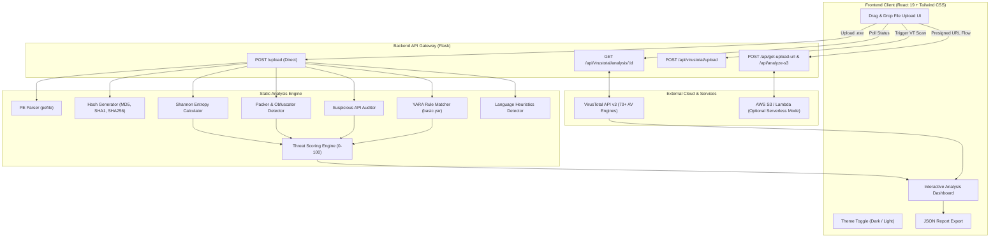

# Silent Scan - Advanced Static Malware Analyzer & Threat Intelligence Platform

<div align="center">


[](https://github.com/vedikalohiya/Static-Analyzer)
[](LICENSE)
[](https://github.com/vedikalohiya/Static-Analyzer)
[](https://react.dev/)
[](https://flask.palletsprojects.com/)

**A cutting-edge static malware analysis platform that provides comprehensive security insights without executing potentially harmful files.**

[Live Demo](https://static-analyzer.vercel.app) | [Documentation](#-features) | [API Reference](#-api-endpoints) | [Report Bug](https://github.com/vedikalohiya/Static-Analyzer/issues) | [Request Feature](https://github.com/vedikalohiya/Static-Analyzer/issues)

</div>

---

## 📌 Overview

Traditional dynamic malware analysis requires spinning up resource-intensive virtual machines and exposes systems to environmental evasion, anti-sandbox triggers, or accidental host infection. 

**Silent Scan** solves this by providing a zero-execution static inspection pipeline. It examines untrusted Windows Portable Executable (`.exe`) files, deconstructs binary headers, analyzes section-level Shannon entropy, matches custom YARA rules, audits suspicious Windows API imports, and aggregates threat verdicts from over 70 commercial antivirus engines via the VirusTotal API v3—all presented within a modern, glassmorphic cybersecurity dashboard.

---

## 🚀 Key Features

### 🔍 Deep Static PE Inspection
- **Cryptographic Hashing**: Instant calculation of MD5, SHA1, and SHA256 hashes for rapid Indicator of Compromise (IOC) matching.
- **PE Header Parsing**: Extracts memory entry points, image base addresses, and COFF compilation timestamps via `pefile`.
- **Language & Compiler Identification**: Uses heuristic analysis of imported runtime DLLs to detect `.NET`, `Visual Basic`, `Python (PyInstaller)`, `C++ (Qt/MSVC)`, or `Native C/C++`.
- **Section Entropy Analysis**: Compares raw versus virtual section sizes and computes Shannon entropy to reveal encrypted or packed payloads.
- **Embedded String Extraction**: Automatically extracts printable ASCII and Unicode strings to uncover hardcoded URLs, IP addresses, registry keys, and commands.

### 🛡️ Advanced Heuristics & Threat Scoring
- **Automated Threat Score (0–100)**: Synthesizes risk vectors into a standardized classification (**Clean**, **Suspicious**, or **Malicious**) with itemized risk explanations.
- **Packer & Crypter Detection**: Identifies known packer signatures such as UPX, ASPack, VMProtect, Themida, Enigma, NsPack, and PECompact.
- **Suspicious API Auditing**: Monitors for dangerous Windows API calls associated with code injection (`VirtualAllocEx`, `WriteProcessMemory`, `CreateRemoteThread`), privilege escalation, and debugger evasion (`IsDebuggerPresent`).
- **YARA Signature Matching**: Runs custom YARA rules (`basic.yar`) to flag cryptographic ransomware patterns, suspicious network download routines, and classic process injection sequences.

### 🌐 VirusTotal Multi-Engine Intelligence
- **70+ Antivirus Engines**: Scans binaries against top security vendors (Microsoft, Kaspersky, CrowdStrike, Sophos, etc.).
- **Live Asynchronous Polling**: Tracks analysis progress in real time until scan completion.
- **Detailed Engine Breakdown**: Transparent table displaying vendor-specific detection results, categories, and clean verdicts.
- **Statistical Overview**: Clear visualization of malicious, suspicious, harmless, and undetected scan outcomes.

### 💻 Modern Cybersecurity UI/UX
- **Glassmorphic Cyber Aesthetic**: Clean, responsive layout with dark/light mode toggle backed by `localStorage`.
- **Drag & Drop Ingestion**: Interactive upload zone with file validation and dynamic progress feedback.
- **Downloadable Reports**: One-click export of complete analysis findings as a structured JSON report.
- **Dual Architecture Support**: Supports direct multipart uploads and cloud-native AWS S3 presigned URL upload pipelines.

---

## 🧮 Threat Scoring Methodology

Silent Scan calculates a transparent, weighted threat score from **0 to 100** based on static risk factors:

| Risk Factor | Criteria | Weight / Points |
| :--- | :--- | :--- |
| **Known Packer** | Section name matches known packer (UPX, ASPack, VMProtect, Themida, etc.) | **+30 points** |
| **High Section Entropy** | Any section Shannon entropy exceeds `7.2` (obfuscation / encryption) | **+15 points** |
| **Suspicious API Calls** | High-risk APIs found in IAT (e.g. `VirtualAlloc`, `CreateRemoteThread`) | **+5 points per API** (Max 40) |
| **YARA Signature Match** | Binary matches one or more compiled YARA detection rules | **+30 points** |

### Verdict Classification:
- 🟢 **Clean (0 - 30)**: Low risk; standard imports, normal entropy, and no known malicious indicators.
- 🟡 **Suspicious (31 - 70)**: Moderate risk; high entropy, suspicious API combinations, or packing detected.
- 🔴 **Malicious (71 - 100)**: Critical risk; confirmed YARA hits, known dangerous packers, and process injection routines.

---

## 🏗️ System Architecture



---

## 🛠️ Technology Stack

| Layer | Component | Description |
| :--- | :--- | :--- |
| **Frontend** | React 19 | Single-page application using hooks and modern component architecture |
| | Tailwind CSS | Utility-first styling with custom glassmorphism effects and animations |
| | Lucide React | High-quality security, dashboard, and interface iconography |
| | Axios & Fetch | HTTP client for direct and presigned file transfer and polling |
| **Backend** | Python 3.10+ | Core language for static binary analysis and processing |
| | Flask & Flask-CORS | Lightweight REST API framework with cross-origin configuration |
| | Werkzeug | Secure filename sanitization and safe file streaming |
| | Gunicorn | Production WSGI HTTP server |
| **Security & Parsing** | `pefile` | Comprehensive parser for Windows Portable Executable headers and sections |
| | `yara-python` | Multi-platform signature detection engine |
| | `hashlib` | Native cryptographic generation for MD5, SHA1, and SHA256 hashes |
| **Cloud & Deployment** | Vercel | Production hosting for the React frontend application |
| | Render | Managed cloud platform running the Flask backend with Gunicorn |
| | AWS SAM / Lambda | Serverless architecture support with AWS S3 and `awsgi` |
| **Threat Intelligence** | VirusTotal API v3 | Cloud multi-engine threat scanning and aggregation |

---

## 📡 API Endpoints

### 1. Direct Static Analysis
```http
POST /upload
Content-Type: multipart/form-data
Body: file=<executable.exe>
```

#### Sample Response:
```json
{
  "filename": "sample_malware.exe",
  "hashes": {
    "md5": "5d41402abc4b2a76b9719d911017c592",
    "sha1": "aaf4c61ddcc5e8a2dabede0f3b482cd9aea9434d",
    "sha256": "2c26b46b68ffc68ff99b453c1d30413413422d706483bfa0f98a5e886266e7ae"
  },
  "pe_info": {
    "entry_point": "0x1240",
    "image_base": "0x400000",
    "compile_time": 1705314645
  },
  "language_guess": "Likely Native C/C++",
  "sections": [
    {
      "name": ".text",
      "virtual_size": "0x1000",
      "raw_size": "0x1000",
      "entropy": 7.34
    },
    {
      "name": ".rsrc",
      "virtual_size": "0x800",
      "raw_size": "0x600",
      "entropy": 4.12
    }
  ],
  "imports": [
    {
      "dll": "KERNEL32.dll",
      "functions": ["VirtualAlloc", "WriteProcessMemory", "CreateRemoteThread"]
    }
  ],
  "packers": ["High Entropy section (.text)"],
  "yara_matches": [
    {
      "rule": "Process_Injection",
      "description": "Detects classic Process Injection API sequence"
    }
  ],
  "threat_score": {
    "score": 85,
    "level": "Malicious",
    "factors": [
      "High entropy in section .text (Likely Packed/Obfuscated)",
      "Found 3 suspicious API imports (e.g., Code Injection, Evasion)",
      "Matched 1 YARA signature(s)"
    ]
  },
  "extracted_strings": ["cmd.exe", "powershell -enc", "http://malicious-c2.com/payload"]
}
```

---

### 2. VirusTotal Scanning Endpoints

#### Upload File to VirusTotal
```http
POST /api/virustotal/upload
Content-Type: multipart/form-data
Body: file=<executable.exe>
```

#### Poll Analysis Status
```http
GET /api/virustotal/analysis/{analysis_id}
```

---

### 3. AWS S3 Presigned URL Endpoints (Serverless Flow)

#### Request Upload URL
```http
POST /api/get-upload-url
Content-Type: application/json

{ "filename": "sample.exe" }
```

#### Trigger S3 Analysis
```http
POST /api/analyze-s3
Content-Type: application/json

{ "file_key": "uuid-sample.exe", "filename": "sample.exe" }
```

---

## ⚡ Quick Start & Local Setup

### Prerequisites
- **Python 3.10+**
- **Node.js 18+** & **npm**
- **VirusTotal API Key** ([Get a free key here](https://www.virustotal.com/))
- *(macOS Optional)*: `brew install yara` (if compiling `yara-python` from source)

---

### 1. Clone the Repository
```bash
git clone https://github.com/vedikalohiya/Static-Analyzer.git
cd Static-Analyzer
```

---

### 2. Backend Setup
```bash
cd backend

# Create and activate Python virtual environment
python3 -m venv venv
source venv/bin/activate       # On Windows: venv\Scripts\activate

# Install required packages
pip install --upgrade pip
pip install -r requirements.txt

# Configure environment variables
cp .env.example .env
# Open .env and add your VIRUSTOTAL_API_KEY and PORT=5000

# Start the Flask development server
python app.py
```
*Backend will be running at `http://localhost:5000`.*

---

### 3. Frontend Setup
```bash
cd ../frontend

# Install dependencies (use --legacy-peer-deps for React 19 compatibility)
npm install --legacy-peer-deps

# Configure environment
cp .env.example .env
# Ensure REACT_APP_API_URL=http://localhost:5000 is set for local testing

# Start React development server
npm start
```
*Frontend will open automatically at `http://localhost:3000`.*

---

## 📁 Project Directory Structure

```
Static-Analyzer/
├── 📄 README.md                      # Primary project documentation
├── 📄 .gitignore                     # Git ignore rules
│
├── 📁 backend/                       # Flask REST API Service
│   ├── 📄 app.py                     # Main application entry point & routes
│   ├── 📄 requirements.txt           # Python package dependencies
│   ├── 📄 .env.example               # Backend environment template
│   ├── 📄 lambda_handler.py          # AWS Lambda handler adapter (awsgi)
│   ├── 📄 template.yaml              # AWS SAM CloudFormation template
│   ├── 📄 render.yaml                # Render deployment specification
│   ├── 📄 procfile                   # Gunicorn process definition
│   └── 📁 analysis/                  # Static analysis core engine
│       ├── 📄 pefile_utils.py        # PE structure parsing & hashing utilities
│       ├── 📄 advanced_analysis.py   # Heuristic threat scoring & packer detection
│       └── 📁 rules/
│           └── 📄 basic.yar          # YARA signature detection rules
│
└── 📁 frontend/                      # React 19 Client
    ├── 📄 package.json               # NPM packages and build scripts
    ├── 📄 package-lock.json          # Deterministic dependency lockfile
    ├── 📄 .env.example               # Frontend environment template
    ├── 📄 tailwind.config.js         # Tailwind design tokens
    ├── 📄 postcss.config.js          # PostCSS build config
    ├── 📁 public/                    # Static assets & icons
    └── 📁 src/                       # Application source code
        ├── 📄 App.js                 # Top-level application layout
        ├── 📄 index.js               # React DOM root render
        ├── 📄 index.css              # Global styles & glassmorphic utilities
        ├── 📁 api/
        │   └── 📄 upload.js          # S3 presigned upload helper
        ├── 📁 pages/
        │   └── 📄 Home.jsx           # Main scanning dashboard
        └── 📁 components/
            ├── 📄 FileUpload.jsx     # Drag & drop upload component
            ├── 📄 AnalysisResult.jsx # Visual analysis dashboard & JSON export
            ├── 📄 GlassCard.js       # Reusable glassmorphic container card
            ├── 📄 Layout.js          # Navigation header & footer layout
            └── 📄 ThemeToggle.js     # Dark/light theme persistence
```

---

## 🔒 Security & Privacy

- **Guaranteed No-Execution**: Files are inspected purely at the byte, header, and signature levels. No binary code is executed.
- **Strict File Type Validation**: Only files possessing a verified DOS `MZ` executable header are accepted.
- **Automated Data Lifecycle**: Files uploaded for inspection are stored in isolated temporary directories (`/tmp`) and deleted immediately after analysis completes.
- **Protected Secrets**: Sensitive API keys and credentials are abstracted into environment variables and never committed to source control.

---

## 🗺️ Roadmap & Future Enhancements

- [ ] **Dynamic Sandboxing Integration**: Async tasks with Celery and Redis to execute malware in isolated Windows VMs (Cuckoo / CAPE Sandbox).
- [ ] **Behavioral Process Graphing**: Visual call-tree representing spawned child processes and registry manipulations.
- [ ] **Network PCAP Sniffing**: Capture outbound DNS and HTTP connections in sandbox mode.
- [ ] **Live WebSocket Streaming**: Real-time event streaming from backend workers to the UI dashboard.
- [ ] **Disassembly Viewer**: Inline assembly opcode visualization for function entry points using Capstone.

---

## 📜 License

This project is licensed under the **MIT License** - see the [LICENSE](LICENSE) file for details.

---

## 📬 Support & Contact

<div align="center">

**Made by [Vedika Lohiya](https://github.com/vedikalohiya)**

[](https://github.com/vedikalohiya)
[](https://linkedin.com/in/vedika2203)
[](mailto:vedika.lohiya22@gmail.com)

**Stay Protected. Analyze Before You Trust.**

</div>
